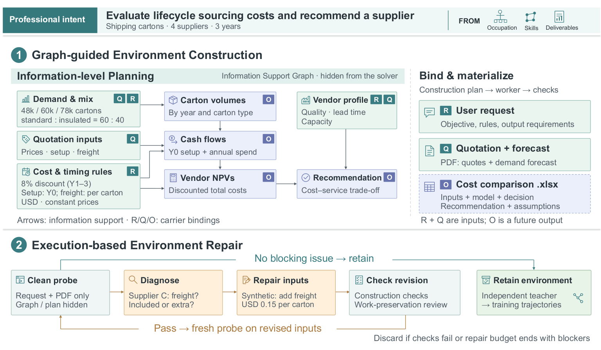
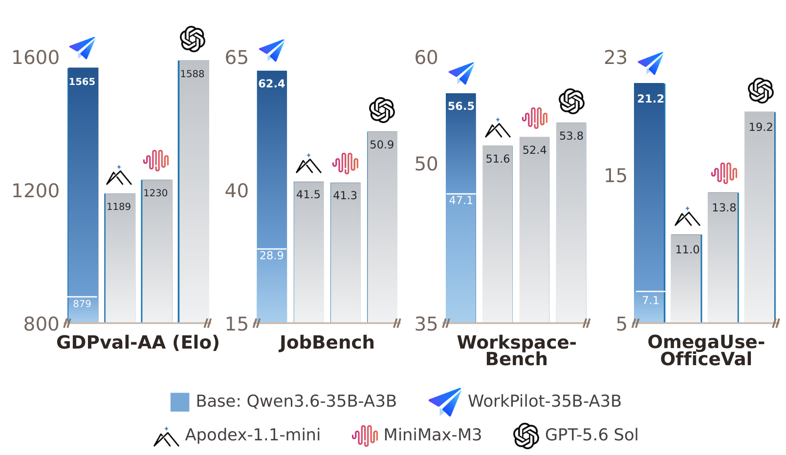

<div align="center">

# WorkFactory

### Turning Professional Intents into Executable Work for Scalable Agent Training

**⭐ Star us if you find this useful!**

<p align="center">
  <a href="https://arxiv.org/pdf/2610.37161"></a>&nbsp;
  <a href="#dataset"></a>&nbsp;
  <a href="#resources"></a>&nbsp;
  <a href="https://github.com/IQuestLab/WorkFactory"></a>
</p>

Ziyang Zeng · Tingyang Chen · Jia Deng · Qiyao Wang<br>
Shuo Tang · Yike Yang · Tao Ren · Wayne Xin Zhao<br>
Feng Chang · Jujie He · Chuan Hao · Ran Tao · Bryan Dai

**[IQuest Research](https://github.com/IQuestLab)**

[Introduction](#introduction) · [Framework](#framework) · [Performance](#performance) · [Dataset & Models](#dataset) · [Contact](#contact) · [Citation](#citation)

</div>

---

## ✨ News

- **[2026.10.27]** 📄 Our paper [WorkFactory](https://arxiv.org/abs/2610.37161) is available on arXiv!

<a id="introduction"></a>

## 💡 Introduction

**WorkFactory** turns professional intents into executable tasks for training working agents. It uses **information-level planning** to organize the facts needed for each deliverable, then **execution-based repair** to fix missing or inconsistent inputs while preserving the intended work.

We construct **112,686 tasks across 612 occupations** and train the **WorkPilot** family at **4B, 27B, and 35B-A3B** scales. All three models improve over their base models across four professional-work benchmarks.

<a id="framework"></a>

## 🏭 Framework

<p align="center">
  
</p>

WorkFactory builds professional intents from occupations, skills, and real deliverables. An **information support graph** guides workspace construction, and clean probe executions check whether the task can be completed. Retained environments are used to collect independent teacher demonstrations for supervised fine-tuning.

*Figure 2 from the [paper](https://arxiv.org/pdf/2610.37161#page=4).*

<a id="performance"></a>

## 📊 Performance

<p align="center">
  
</p>

**WorkPilot-35B-A3B** improves from **879 to 1565 Elo** on GDPval-AA v2.1, alongside gains on JobBench, Workspace-Bench, and OmegaUse-OfficeVal. **WorkPilot-27B** reaches **1612 Elo**, while **WorkPilot-4B** reaches **1375 Elo**.

*Figure 1 from the [paper](https://arxiv.org/pdf/2610.37161#page=2). WorkPilot Elo scores are local estimates calibrated to GDPval-AA v2.1. See Table 2 and Appendix E for full results and evaluation details.*

<a id="dataset"></a>

## 🤗 Dataset & Models

The full training corpus covers **112,686 tasks**, **612 occupations**, and **23 occupational groups**, with an average of **4.15 reference files per task**. Teacher demonstrations train WorkPilot-4B, WorkPilot-27B, and WorkPilot-35B-A3B.

| Resource | Hugging Face |
| :--- | :---: |
| WorkFactory Dataset | [](#dataset) |
| WorkPilot Models | [](#models) |

<a id="models"></a>

<a id="resources"></a>

<!-- TODO: Replace #dataset in the header and dataset row with the Hugging Face dataset URL; replace #models in the model row with the Hugging Face model URL. Replace #resources in the header with the Hugging Face paper URL. -->

<a id="contact"></a>

## 📬 Contact

For questions or collaboration, please contact **Ziyang Zeng** ([yling@iquestlab.com](mailto:yling@iquestlab.com)) or **Tingyang Chen** ([chenty@zju.edu.cn](mailto:chenty@zju.edu.cn)).

## 📄 License

This repository is licensed under the [Apache License 2.0](LICENSE).

<a id="citation"></a>

## 📝 Citation

If you use WorkFactory or WorkPilot in your research, please cite:

```bibtex
@misc{zeng2026workfactory,
  title         = {WorkFactory: Turning Professional Intents into Executable Work for Scalable Agent Training},
  author        = {Ziyang Zeng and Tingyang Chen and Jia Deng and Qiyao Wang and Shuo Tang and Yike Yang and Tao Ren and Wayne Xin Zhao and Feng Chang and Jujie He and Chuan Hao and Ran Tao and Bryan Dai},
  year          = {2026},
  eprint        = {2610.37161},
  archivePrefix = {arXiv},
  primaryClass  = {cs.AI},
  url           = {https://arxiv.org/abs/2610.37161}
}
```
